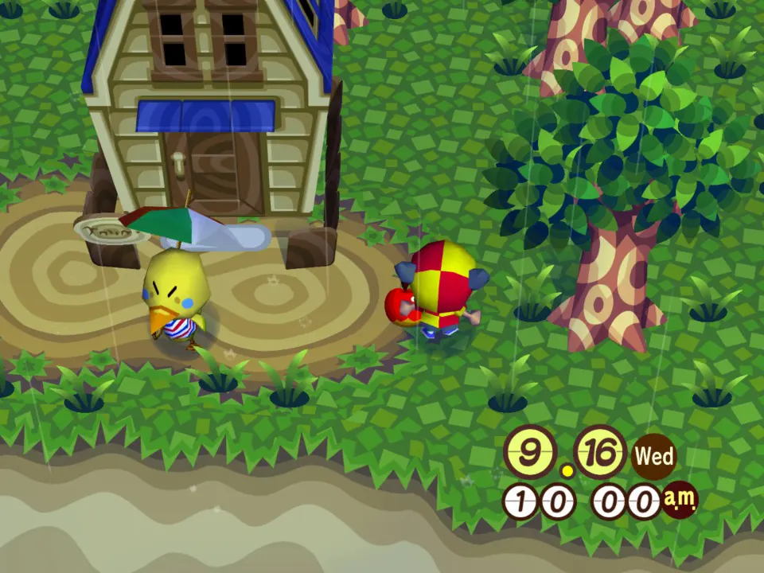
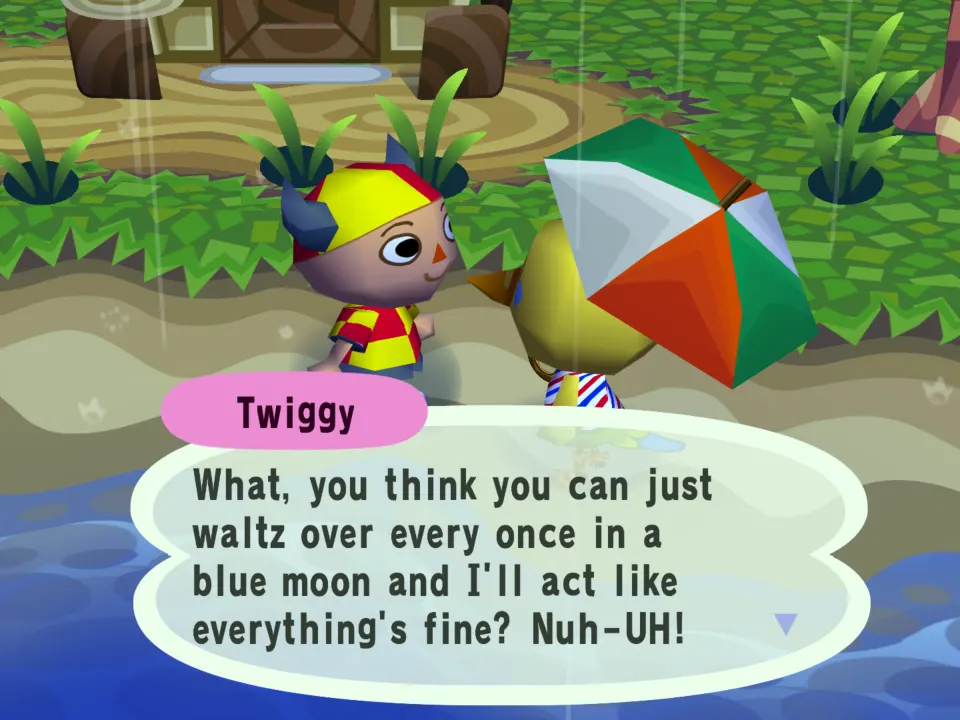
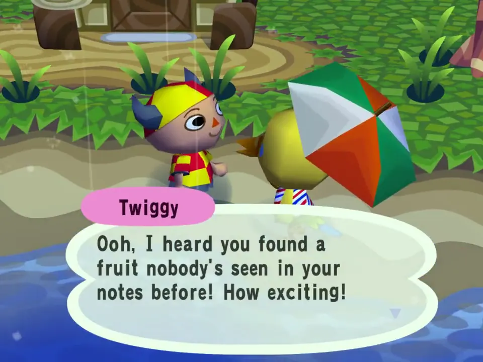

# Field Notes

Your own naturalist's journal. Every bug, fish, fossil, shell and piece of
fruit you collect goes in your notes. Villagers have something to say about
it:

## In the game

Picking an apple up by Twiggy's house. Every bug, fish, fossil, shell and fruit you pick up goes in your field notes.

The next villager you talk to notices the find: a fruit you had never noted before, so your field notes grew a new page.

Then the villager carries on in their own words, as the game always has them.

The film (click the picture): An apple is dropped from the pockets and picked up again, and Twiggy has something to say about the new page in your notes.

- today's haul ("2 bugs, a fish and a piece of fruit so far today!")
- a kind you have never noted before, and your very first fossil
- a new best day for one kind ("3 bugs today, a new best!")
- milestones at 25, 50, 100, 250 finds and on
- yesterday's summary, from the first villager you talk to on a new day. If
  you were away, they sum up your last day out.

Each villager speaks for Field Notes at most once a day, and only when there
is something to say. Other talk mods, such as Village Gossip, still get their
turn.

A villager busy with something of the game's own does not speak for any mod
on that talk. That covers an errand, a complaint and moving out. Their note is
kept for the next talk.

## Install

1. Download `example.field-notes-1.0.0.zip` from the modding downloads page.
2. In the game, go to Settings, Mods, Choose a file, then Restart now.

## What it shows

- `item_picked_up` with item numbers. `e.item` is only the number, so
  `classify()` in `main.lua` sorts it by the game's item number ranges:

  | kind | item numbers |
  |---|---|
  | bugs | `0x2D00` to `0x2D27` |
  | fish | `0x2300` to `0x2327` |
  | fossil (not yet identified) | `0x2511` |
  | shells | `0x2514` to `0x251B` |
  | fruit | `0x2800` to `0x2804`, coconut `0x2807` |

- `store` kept small. Counts are one string each (`"3,1,0,2,5"`). Species seen
  are a string of `0` and `1`. It is a few hundred bytes in all. A `store.set`
  that would go over 8 KB raises an error, so `save()` wraps it in `pcall`.
- `day_started` rolls today over to yesterday. `villager_talked` reads it once.
- `game.day_number()` counts the days between two finds. `rng()` picks one of
  a line's wordings.
- `message()` templates with `{haul}`, `{n}`, `{old}` and others filled in, so
  the words stay in `messages/en.json`.
- `villager_talked` returns `nil` when there is nothing to say, so the next
  mod in the list gets the villager.

## Notes

- `store` is per town, so each town keeps its own journal. It travels with
  that town's cloud save. On a visit to a friend's town the journal starts
  empty and is not kept.
- The day comes from `day_started`. A clock change backwards counts as a new
  day.
- Every item that lands in your pockets counts, because the game fires
  `item_picked_up` for each one. That includes items picked up off the ground,
  bugs caught with the net, fish caught with the rod and items dug up.
- It is tested in the real script sandbox with fake finds, so every line it
  can say has been heard.
