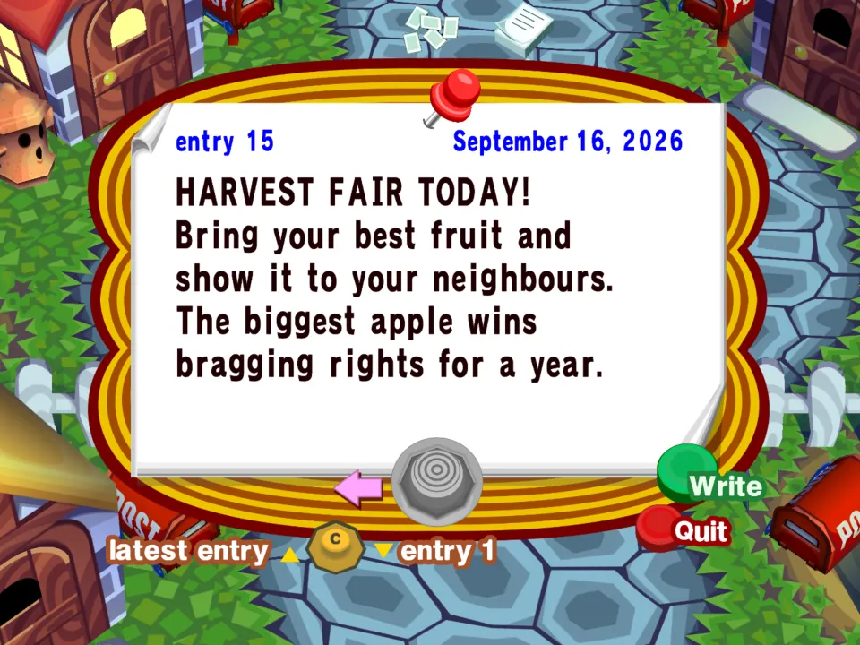
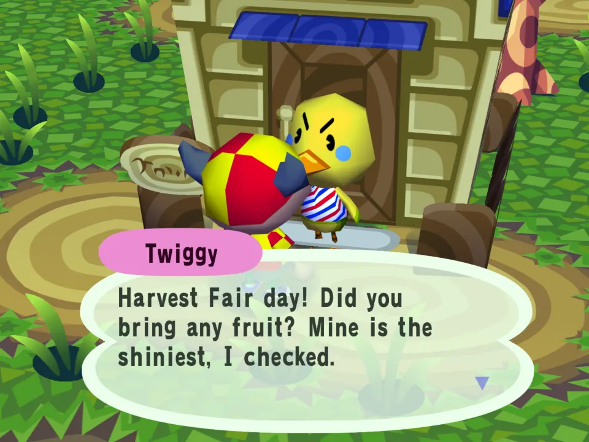
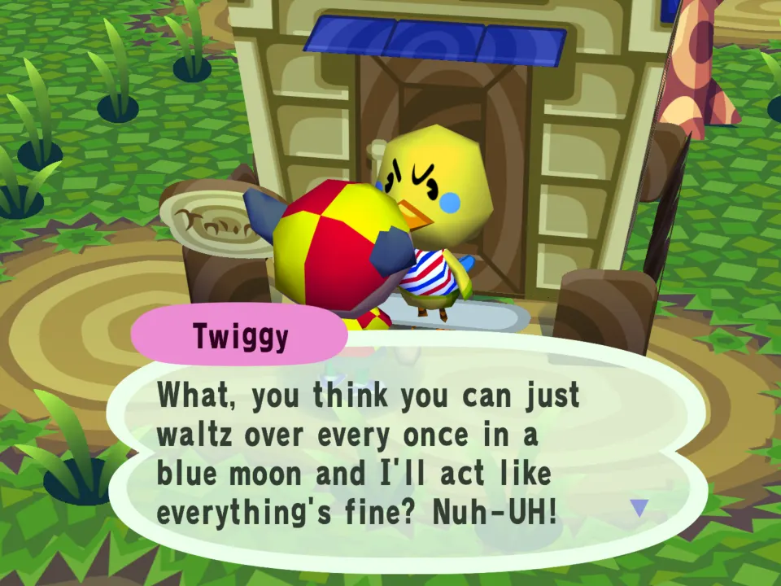
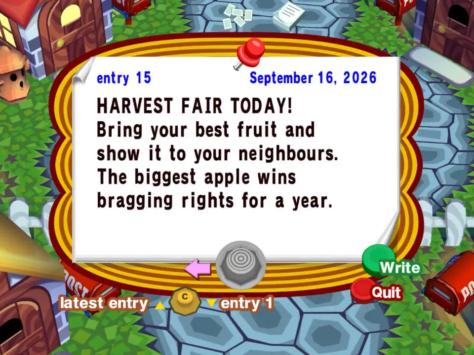

# Harvest Fair

A calendar example (`calendar.json`) with a letter template
(`letters.json`).

## In the game

On the third Wednesday of September the town bulletin board carries the mod's notice, dated by the game.

All day, villagers open with a line about the fair from the mod's calendar.json.

Then the villager carries on in their own words: the fair line comes first, nothing of the game's is lost.

The film (click the picture): The Harvest Fair notice on the bulletin board, then Twiggy talking about the fair before her usual chat.

- It adds two calendar days. The Harvest Fair is the third Wednesday of
  September (`week` 3, `weekday` 3). Apple Day is October 21 (`day`).
- On each day a notice goes up on the town bulletin board. It is posted once,
  in the player's own town only. Villagers say one of the day's lines before
  their hello.
- A board notice changes the town, so this is a World mod
  (`"scope": "world"`).
- `fair-thanks` is a letter that a mod command can mail. Use `send_letter` and
  name it `example.harvest-festival:fair-thanks`. The player's name goes where
  `{player}` is, and an apple comes with it.
- The letter signs "The Fair Committee". The mailbox list has room for 8
  characters, so `sender` names it "The Fair" there.

Letter and notice text is plain ASCII and must fit six lines of the paper. The
game measures it in its own font and refuses text that does not fit.
