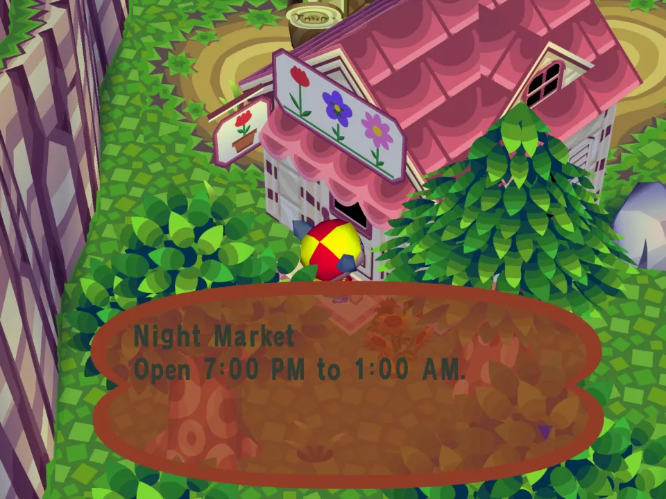
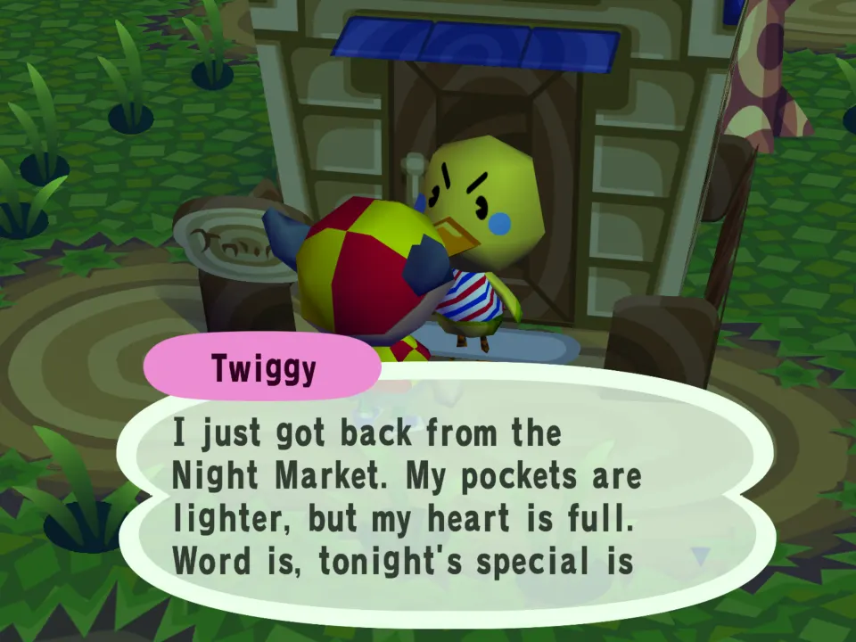
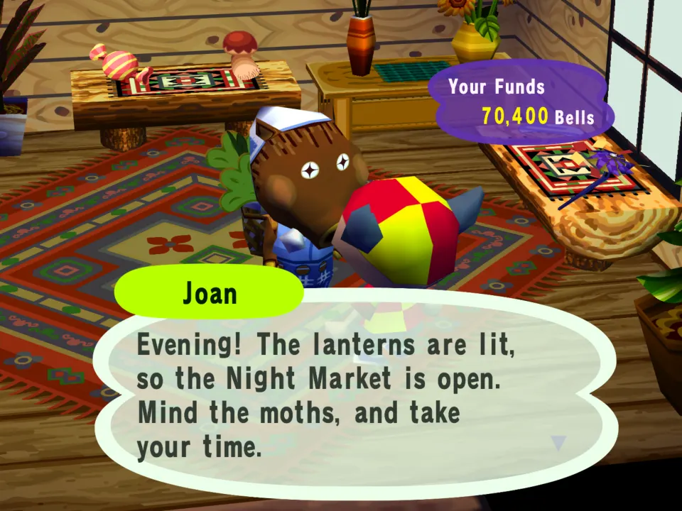
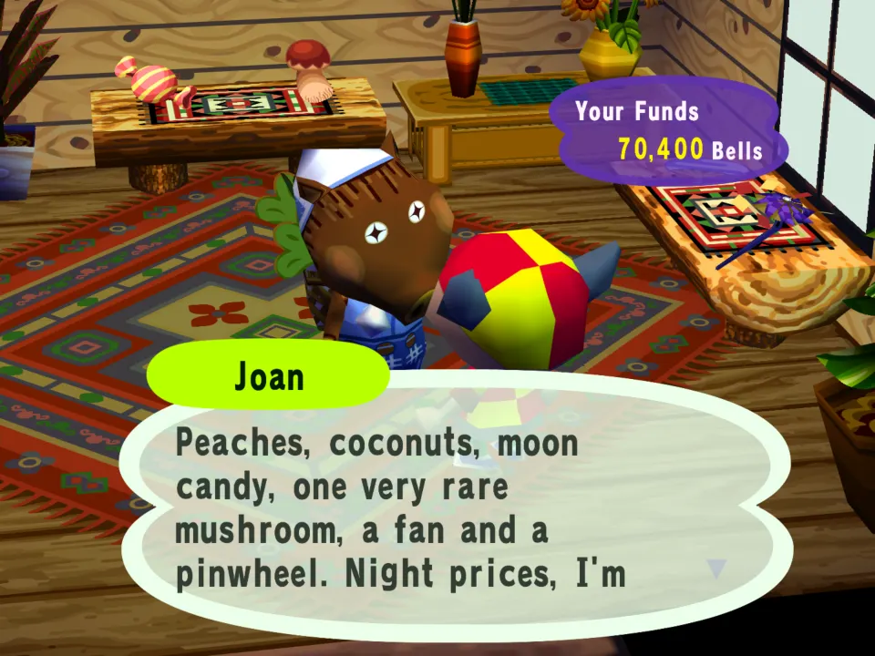
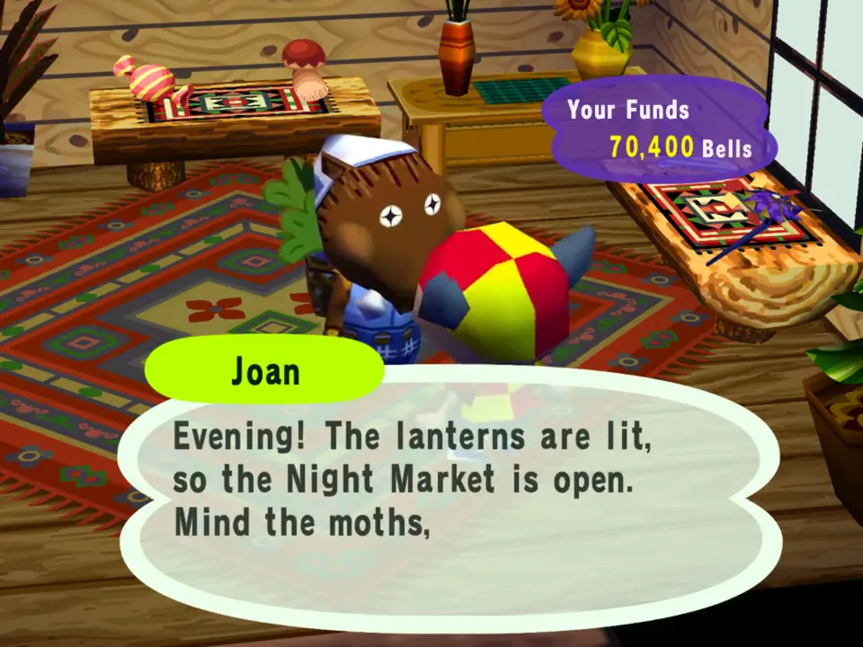

# Night Market

A World mod (`"scope": "world"`) that puts a shop and a script together.

## In the game

At noon the flower shop is shut and its sign is the mod's: Night Market, open 7:00 PM to 1:00 AM.

A villager who has heard mentions tonight's special. Hints is a client setting: each player switches it off for themselves, and the shop stays as it is.

Joan greets you with the mod's words: the lanterns are lit, so the Night Market is open.

Ask what's in stock and she names the night's goods: peaches, coconuts, moon candy, a rare mushroom, a fan and a pinwheel.

The film (click the picture): Knocking at noon gets the Night Market sign; at 8 PM the shop is open, and Joan's greeting and stock line are the mod's.

## The shop

`shops.json` turns the flower shop into the Night Market after dark:

- It is open 7 PM to 1 AM. The rest of the day the door stays shut and its
  sign reads "Night Market / Open 7:00 PM to 1:00 AM."
- It has its own greeting and its own answer to "What's in stock?".
- It sells six goods, one per table:

  | item | | price |
  |---|---|---|
  | `0x2803` | peach | 800 |
  | `0x2807` | coconut | 700 |
  | `0x2806` | candy | 500 |
  | `0x2805` | mushroom | 6000 |
  | `0x2257` | fan | 900 |
  | `0x2253` | pinwheel | 1200 |

Every price sits above the game's floor for the item, so the game never raises
it. The floors:

- A town fruit like the peach sells to Nook for 500 Bells when it comes from
  another town. So the flower shop sells one for at least 500.
- A coconut's floor is only its own buy-back, 150.
- Candy's floor is 25.
- The mushroom sells to Nook for 5000, hence its price.

## The script

From 5 PM, a few villagers mention the market (`main.lua`). Before 7 they say
it opens soon. After 7 they say it is open, and name "tonight's special".

- `day_started` picks tonight's special from `game.day_number()`. It changes
  every day and walks through all six goods in six days. Just past midnight,
  before the market shuts at 1, villagers still mean last night's special.
- `game.time().hour` decides what they say, and keeps them quiet in the day.
- It speaks rarely, so it shares villagers with other mods. About one villager
  in three speaks, the same ones all night. At most three speak before 7 and
  three after.
- A villager says each line once a night, in one of three wordings picked with
  `rng()`.
- Everyone else is left for other mods' lines. The first mod that returns a
  line wins a talk.

## The setting

`mod.json` declares one setting, "Villagers mention the market". The player
switches it on the Mods tab.

- It is a client setting (`"scope": "client"`). It decides only what its own
  player hears, so it is the player's own.
- A friend visit does not compare it. Two friends with the Night Market can
  visit each other with different choices. A visitor who borrows the host's
  mods keeps their own choice too.
- A setting with no `scope` is a world setting. A visit compares those, because
  they are part of the town.
- The script reads it in `villager_talked`, an event that only talks. In an
  event that read a client setting, the game refuses `cmd.send_letter`,
  `cmd.give_item`, `cmd.take_item` and `cmd.take_bells` with the code
  `command-client-setting`. A client setting may not decide what the town gets
  or gives up.

## What it can't do

The special is talk only. The stock and its prices are the same every night.
`shops.json` is data the game reads once when it starts, and a script has no
way to change a shop. A villager calling the peach "tonight's special" does
not make it cheaper.

Other mods can read the market's hours as `example.night-market:hours`.
