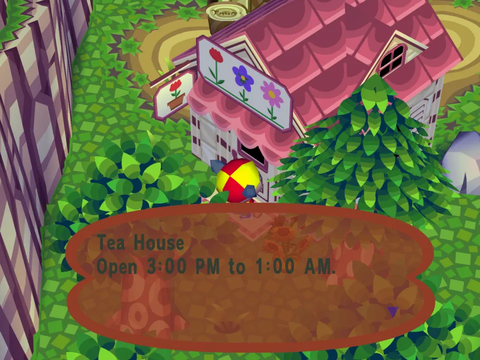
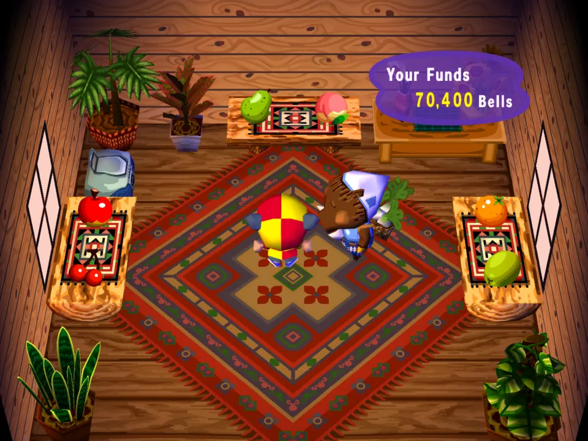
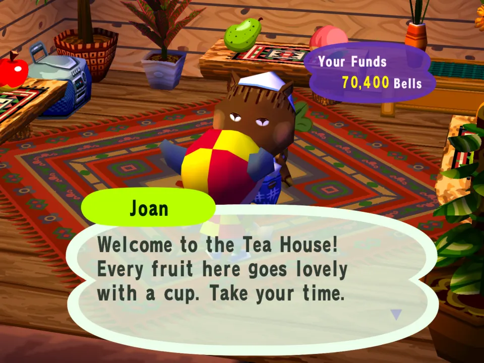
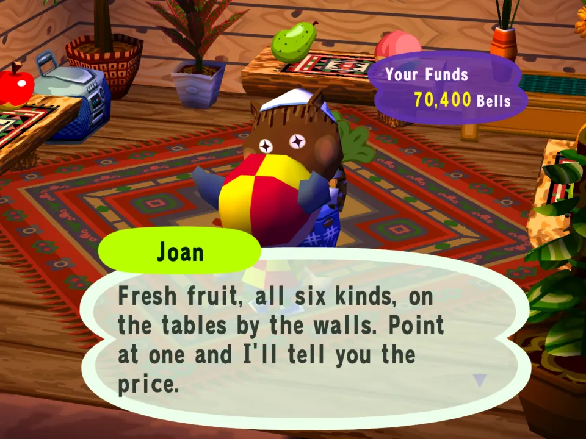

# Tea House

A World mod (`"scope": "world"`) that turns the flower shop into a tea house in
the evening, in five languages.

## In the game

At noon the flower shop's door stays shut and its sign is the mod's: Tea House, open 3:00 PM to 1:00 AM.

Inside at 6 PM: the tables hold the mod's six fruits, at the mod's prices.

Joan greets you with the mod's words from shops.json.

Ask her what's in stock and she answers with the mod's stock line.

The film (click the picture): Knocking at noon gets the Tea House sign and its hours; in the evening the shop is open, and a chat with Joan is the mod's greeting and stock line.

## The shop

`shops.json` gives the flower shop a name, hours, a greeting, an answer to
"What's in stock?" and six goods with prices. A shop changes the town, so the
mod is a World mod.

`messages/en.json` holds one line, `hours`. Other mods can read it as
`example.tea-house:hours`. The Village Gossip example does.

## In other languages

`"translations": "translations/"` in `mod.json` names a folder with the shop's
texts in German, Spanish, French and Italian.

- Each file is one list of key and text. A key is the path of a text:
  `shops/flower/name`, `shops/flower/greeting`, `shops/flower/stock_line`.
- `mod/name` and `mod/description` are the mod's own name and description. The
  Mods tab shows them. The game does not.
- There is no `en.json`. English is the text in `shops.json` itself.
- The game shows a text in its own language when that language's file has it.
  It shows the English text when not. Each text is decided alone.
- A translation follows the rule of the text it replaces. A greeting is at most
  160 characters with at most 3 line breaks, in every language.
- A shop line can use the accented letters the game's font has, such as the "é"
  in "thé". A letter or a board notice cannot.

To try a language on any disc, turn developer mode on and add `?modlang=de` to
the game's address.
