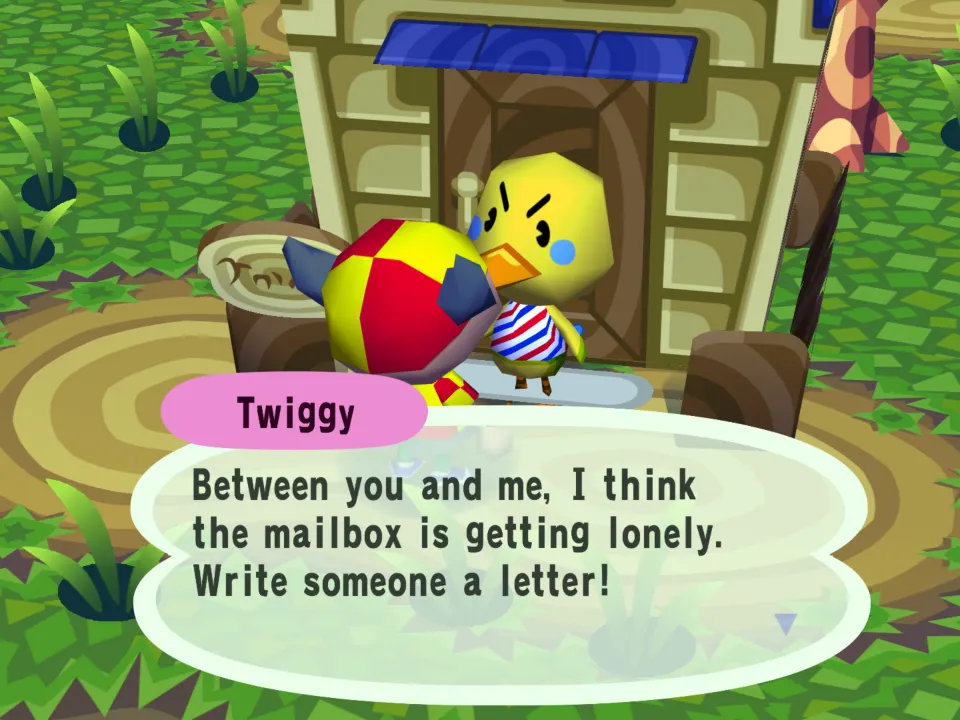
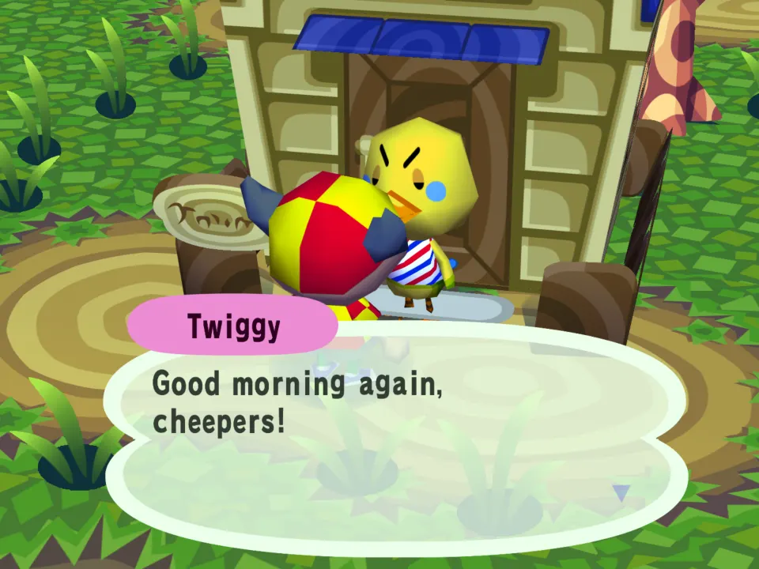
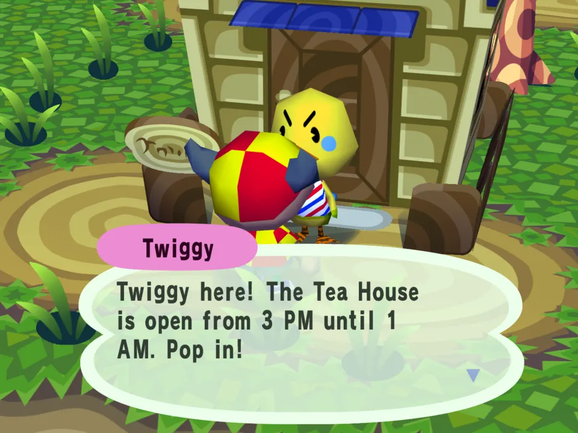

# Village Gossip

A Just you mod (`"scope": "client"`) with a small script. Once a day each
villager you talk to shares a line of gossip before their usual hello.

## In the game



The first talk of the day with a villager opens on a bit of town gossip from the mod's script, in the villager's own window.


The next page is the villager's own words: the gossip comes before the conversation and never replaces it.



Talk to the same villager again that day and there is no gossip: once a day per villager.



The Tea House is an optional dependency. When it is installed, one first talk in three mentions it, with words from the Tea House mod.

[](../../examples-media/example.village-gossip/film.mp4)

The film (click the picture): Walking up to Twiggy: her first talk of the day starts with the mod's gossip, then carries on as usual. A second talk that day has no gossip.

## The script

- `villager_talked` returns one of four lines from `messages/en.json`, picked
  with `rng()`. Each villager says one a day.
- `day_started` clears the list of villagers who have spoken, and counts the
  days in `store`.

## A mod it can use but does not need

`mod.json` names the Tea House example in `optional_depends`:

```json
"optional_depends": { "example.tea-house": ">=1.0.0" }
```

- This mod loads with or without the Tea House. A needed mod goes in `depends`
  instead, and a mod with a missing `depends` entry does not load.
- When the Tea House is installed and switched on, it loads before this mod.
- `remote.version("example.tea-house")` returns its version when it is there.
  It returns `nil`, a message and a code when it is not. The script asks in
  `villager_talked`, an event, not at the top of the file.
- With the Tea House there, one talk in three mentions its hours. The line is
  the Tea House's own, read with `message("example.tea-house:hours")`.
- The Mods tab says so on this mod's row. With the Tea House on, it reads
  "Works with Tea House, which you have on." Without it, or with it off, it
  reads "Also works with Tea House". It is never shown as a problem.
