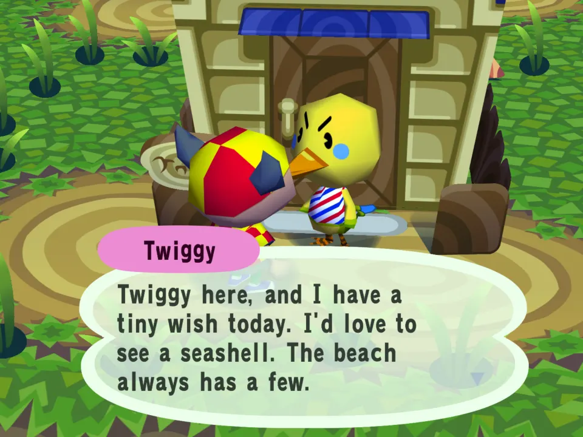
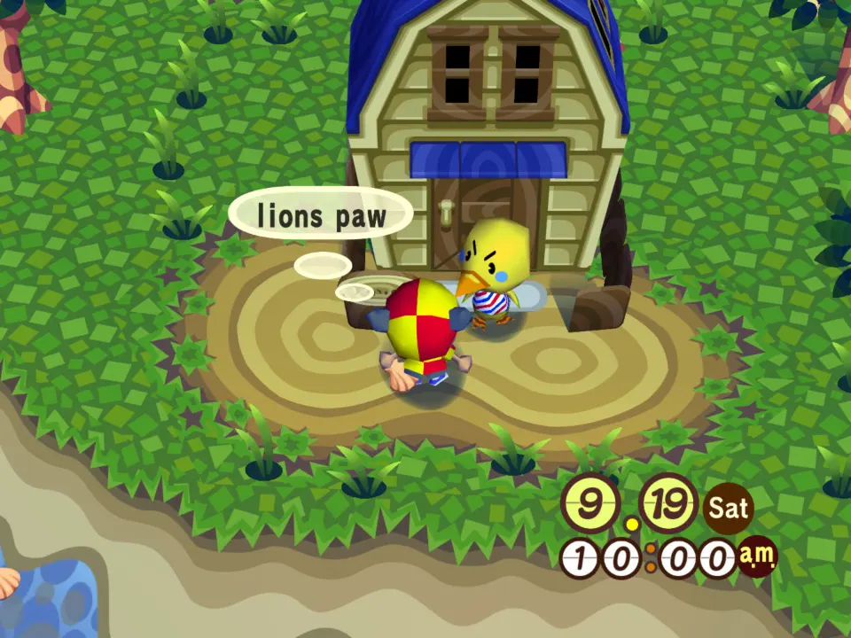
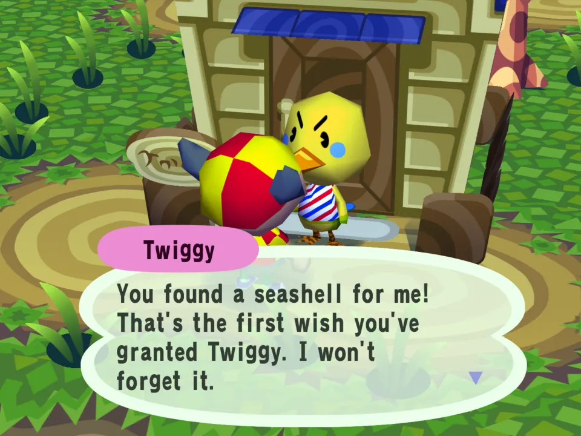
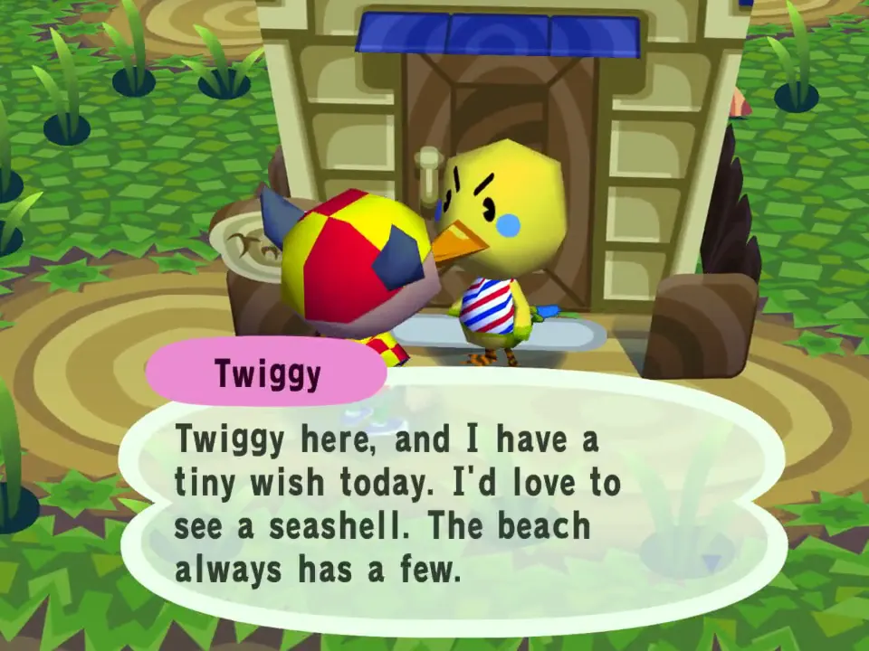

# Wish List

A script example with tiny daily quests.

## In the game

Twiggy has a tiny wish today: a seashell. About two villagers in five wish each day, picked from the date.

A lion's paw shell, dropped from the pockets and picked up off the ground: the script hears item_picked_up and grants the wish.

The next talk opens on her thank-you, and the script counts your wish streak with her.

The film (click the picture): Twiggy wishes for a seashell; one is picked up, and her next talk thanks you for the first wish granted.

Each day about two villagers in five make a wish. A wish is one of these:

- a seashell
- a piece of fruit
- a bag of Bells
- a mushroom, in November
- a fruit you have picked up before, so nobody wishes for a fruit that does
  not grow in your town

Who wishes comes from the date and the villager. A wish once told is saved, so
it is the same all day, after a restart too. Each resident of the town has
their own wishes and their own streaks.

1. Talk to a villager. If they have a wish today, they tell you, once.
2. Pick the thing up from the ground. Shake a tree, walk the beach or hit a
   rock.
3. Talk to them again. They thank you and count your **wish streak**, the
   wishes granted in a row. Three, five, ten and every ten after that get
   their own line.

A wish the day ends on breaks the streak. The villager mentions it, kindly,
the next time they wish.

Sometimes a villager has something of the game's own to say, such as an
errand, a complaint, moving out or a pitfall. That talk belongs to the game
and no mod hears it, so the wish or the thank-you waits. Talk to them once
more and it comes. Nothing is lost. A granted wish counts for your streak the
moment you pick the thing up.

## What it does not do

Mod handlers only return data. A script cannot give items, Bells or friendship
points, or change anything in the town. The reward is the story and the
streak.

A wish is granted when the item lands in your pockets or wallet
(`item_picked_up`). Picking it up, catching it and digging it up all count.
Buying it does not. Wishes stick to things found around town: shells, fruit,
Bells and mushrooms. Dropping a shell and picking it back up counts. The
villagers are trusting folk.

## How it is built

- `main.lua` uses `villager_talked`, `day_started` and `item_picked_up`.
- Special talks never call `villager_talked`. The scripts guide lists them. A
  wish is marked told, and a thank-you marked given, only inside a
  `villager_talked` that returns the line. So a talk the game kept for itself
  loses nothing, and the next ordinary talk says it.
- `villager_talked` returns nil unless it has a wish to state or a thank-you
  to give. With other talk mods installed it takes only the villagers it has
  news for. The first mod in load order with a line wins a talk.
- Who wishes is a hash of the date and `e.villager.id`. Which wish is `rng()`.
- The day comes from `game.time()`, so it also changes past midnight and after
  a clock change. `day_started` alone would miss a save loaded on the day it
  was last played.
- `store.player` keeps today's wishes, so a restart does not repeat them. It
  also keeps the fruits you have picked up, and each villager's
  `streak,total,missed` for the 48 villagers seen most recently.
- That is under 2 KB for one resident. All four residents share the mod's
  8 KB in the town.
- Every `store.player.set` is wrapped in `pcall`, because a refused write must
  not stop the script.
- `store.player` is per town and per player.
- It runs under 2,000 instructions per event with 60 villagers, against a
  budget of 200,000.
- Lines are in `messages/en.json`, with `{name}`, `{wish}`, `{hint}` and
  `{streak}` filled in by the script.

It is tested in the real script sandbox against these exact files.
